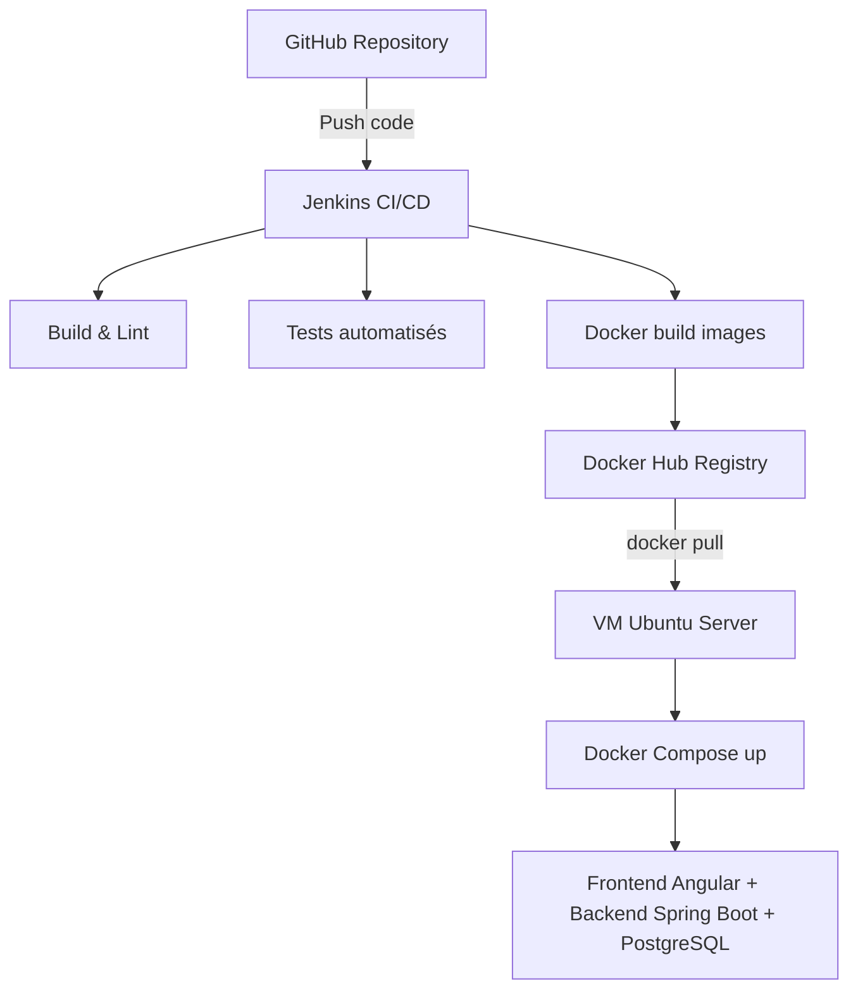

# 🏃 SprintDashboard

Une application web de gestion des indicateurs de performance (KPIs) des sprints Agile, avec intégration de la plateforme Jira via des API REST.

## 🚀 Objectifs

* Visualiser les KPIs des sprints Agile : vélocité, taux de complétion, etc.
* Centraliser les données Jira dans un tableau de bord interactif.
* Suivre la performance des équipes.

## 🛠️ Technologies

### Backend

* Spring Boot
* Java 17+
* REST API
* Jira REST API

### Frontend

* Angular
* TypeScript

### DevOps & déploiement

* Git & GitHub
* Jenkins (CI/CD automatisé)
* Docker & Docker Compose
* Docker Hub
* Ubuntu Server (VM de déploiement)

---

## ⚙️ Fonctionnalités CI/CD

La pipeline CI/CD réalisée avec **Jenkins** comprend :

1. **Checkout** du code source depuis GitHub.
2. **Build & linting** du frontend et du backend.
3. **Tests automatisés** pour assurer la qualité du code.
4. **Construction des images Docker** pour le backend et le frontend.
5. **Push des images Docker** vers **Docker Hub**.
6. **Déploiement** sur la VM Ubuntu via **Docker Compose** (récupération des images et lancement), avec connexion SSH sécurisée si nécessaire.

---

## 📂 Organisation du projet

```
SprintDashboard/
├── backend/           # Code source Spring Boot
├── frontend/          # Code source Angular
├── docker-compose.yml
├── Jenkinsfile
└── README.md
```

---

## 🚀 Déploiement avec CI/CD

* Jenkins exécute automatiquement le pipeline à chaque push sur GitHub.
* Les images Docker sont construites puis envoyées sur Docker Hub.
* La VM Ubuntu récupère les images via `docker-compose pull` puis lance l’application avec `docker-compose up -d`.

---

## 📊 Schéma d’architecture CI/CD



---

## 📸 Résultats

🔹 Interface Dashboard (KPIs des sprints)


🔹 Jenkins — pipeline CI/CD en exécution


---

## ✨ Auteur

👤 **Ahmed Belhassen**
📧 [ahmed.belhassen@supcom.tn](mailto:ahmed.belhassen@supcom.tn)
🔗 [LinkedIn](https://www.linkedin.com/in/ahmed-belhassen-551b042bb/)

---

